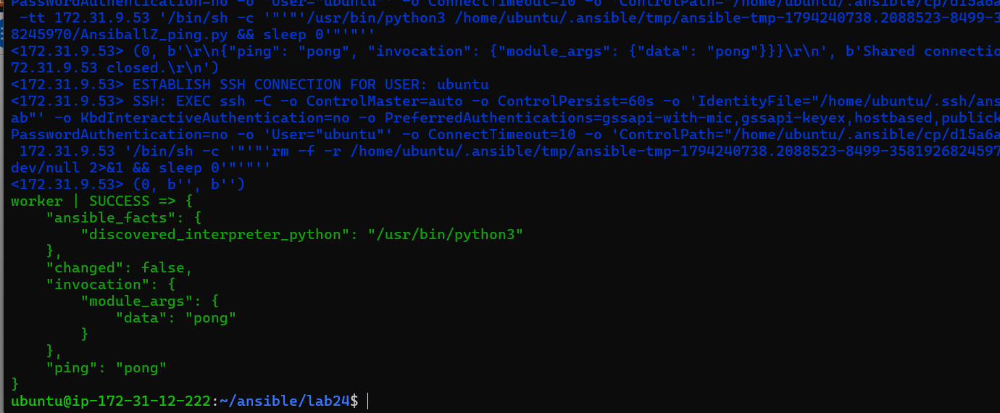
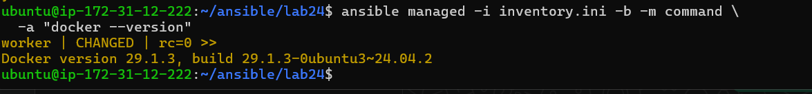
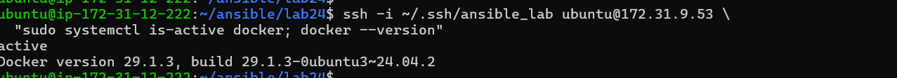

# Ansible Configuration and Ad-Hoc Execution

## Objective

Configure an Ansible control node, connect to an Ubuntu managed node over SSH, build an inventory, verify connectivity, and install Docker with an ad-hoc command.

## Lab environment

- **Control node:** Ubuntu 24.04 EC2 instance (`ip-172-31-12-222`)
- **Managed node:** Ubuntu 24.04 EC2 worker (`172.31.9.53` on the private network)
- **Ansible:** 9.2.0 / ansible-core 2.16.3
- **SSH:** ED25519 Ansible key for controller-to-worker access
- **Docker:** Ubuntu `docker.io` package

Replace addresses and usernames with values from your own environment when repeating these steps.

## 1. Install Ansible on the control node

```bash
sudo apt update
sudo apt install -y ansible
ansible --version
```

The control node runs Ansible. The managed node does not need an Ansible agent; Ansible connects to it over SSH and uses Python to run modules.

## 2. Configure SSH access to the worker

Generate a dedicated key pair on the control node. The private key stays there; only the public key is added to the managed user's `~/.ssh/authorized_keys` file.

```bash
install -d -m 700 ~/.ssh
ssh-keygen -t ed25519 -f ~/.ssh/ansible_lab -N ""
cat ~/.ssh/ansible_lab.pub
```

The public key was installed on the worker using the existing EC2 access method. Verify controller-to-worker SSH using the private address:

```bash
ssh -i ~/.ssh/ansible_lab ubuntu@<WORKER_PRIVATE_IP>
```

Type `exit` to return to the control node. Never copy or commit `~/.ssh/ansible_lab` (the private key), the EC2 `.pem` file, or credentials.

## 3. Create the inventory

Create a private working file named `inventory.ini` based on [`inventory.example.ini`](inventory.example.ini):

```ini
[managed]
worker ansible_host=<WORKER_PRIVATE_IP> ansible_user=ubuntu ansible_ssh_private_key_file=/home/ubuntu/.ssh/ansible_lab
```

The inventory groups the target under `managed` and specifies its private IP, SSH account, and Ansible key. Check that Ansible parsed it:

```bash
ansible-inventory -i inventory.ini --list
```

## 4. Verify connectivity with the Ansible ping module

```bash
ansible managed -i inventory.ini -m ping
```

Expected result:

```text
worker | SUCCESS => {
    "changed": false,
    "ping": "pong"
}
```

This is Ansible's `ping` module. It verifies SSH access and Python execution on the managed host; it is not an ICMP ping.



## 5. Install Docker with an ad-hoc command

```bash
ansible managed -i inventory.ini -b -m apt \
  -a "name=docker.io state=present update_cache=yes"
```

- `-b` runs the task with elevated privileges (sudo).
- `-m apt` selects the Ubuntu package-management module.
- `state=present` ensures Docker is installed and is safe to rerun.

The first run reported `CHANGED` and installed Docker on the worker.

## 6. Verify Docker

Check the installed version through Ansible:

```bash
ansible managed -i inventory.ini -b -m command \
  -a "docker --version"
```

The worker returned Docker `29.1.3`. Verify the service and version directly over SSH as well:



```bash
ssh -i ~/.ssh/ansible_lab ubuntu@<WORKER_PRIVATE_IP> \
  "sudo systemctl is-active docker; docker --version"
```

Expected service state: `active`.



## Files

- `inventory.example.ini` — sanitized inventory template; replace the placeholder address before use.
- `.gitignore` — excludes the real inventory and private key files.
- `screenshots/` — terminal evidence for the steps below.

The working `inventory.ini` and SSH private keys must remain outside Git.

Screenshots are embedded beside the steps they document. They show the Ansible connectivity check, Docker version returned by Ansible, and Docker service verification. Do not include private keys or credentials in screenshots.

## Result

Ansible on the control node connected to the worker over SSH, discovered its Python interpreter, and installed Docker with an ad-hoc `apt` task. Docker version `29.1.3` and the active service state were confirmed on the worker.
